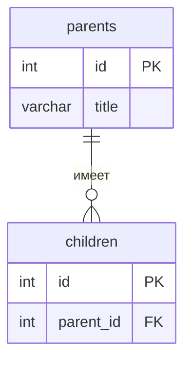

<!--
  Это шаблон README проекта. После создания своего репозитория:
  1. Переименовать репозиторий в backend-<фамилия>-<тема>, например backend-ivanova-library.
  2. Заполнить разделы ниже под свою тему и удалить этот комментарий.
  Задания лаб лежат в папке docs/, начинать с docs/README.md.
-->

# Название проекта

Тема №__: **...**. Одна фраза: что это и для кого.

| | |
| --- | --- |
| Главная сущность | ... |
| Связанная сущность (1:N) | ... |
| Фишка | ... |
| Стек | язык, фреймворк, база данных |

## Как запустить

```bash
# 1. Клонируем репозиторий 
git clone https://github.com/Patison228/backend-bulletin_board
cd backend-bulletin-board

# 2. Создаем виртуальное окружение
python -m venv .venv

# 3. Активируем окружение 
.venv\Scripts\Activate.ps1

# 4. Устанавливаем зависимости
pip install -r requirements.txt

# 5. Запускаем сервер
uvicorn main:app --reload
```

Сервис работает на `http://localhost:8000`. Запросы для демонстрации лежат в `requests.http`.

## Эндпоинты

| Метод | Путь | Что делает | Ответ |
| --- | --- | --- | --- |
| GET | `/health` | Проверка, что сервис жив | 200 `{"status":"ok"}` |
| POST | `/api/ads` | Создать объявление | 201 и объект с `id`; 400 при ошибке |
| GET | `/api/ads` | Список объявлений (с пагинацией и фильтром по статусу) | 200 |
| GET | `/api/ads/{id}` | Получить одно объявление | 200; 404 |
| PATCH | `/api/ads/{id}` | Изменить объявление | 200; 400; 404 |
| DELETE | `/api/ads/{id}` | Удалить объявление | 204; 404 |
| POST | `/api/ads/{id}/responses` | Оставить отклик на объявление | 201; 409 (если объявление `sold`); 404 |
| GET | `/api/ads/{id}/responses` | Получить все отклики для объявления | 200; 404 |
| GET | `/api/stats` | Получить статистику (кол-во откликов) | 200 |

## ER-диаграмма

<!-- С лабы 2. Блок mermaid GitHub рисует сам. -->



## Интерфейс

<!-- С лабы 4: скриншот, например  -->
